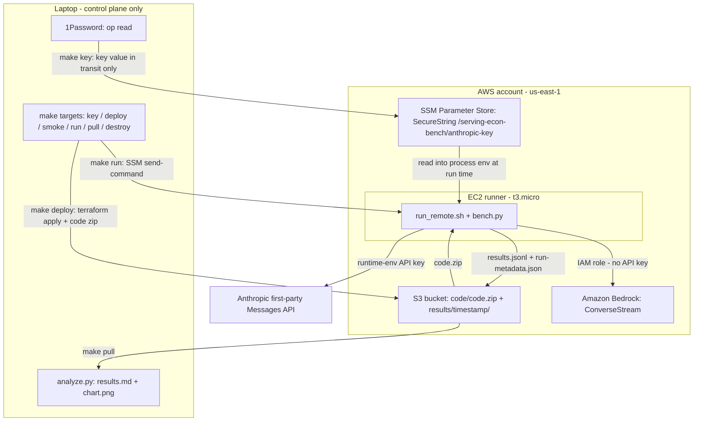
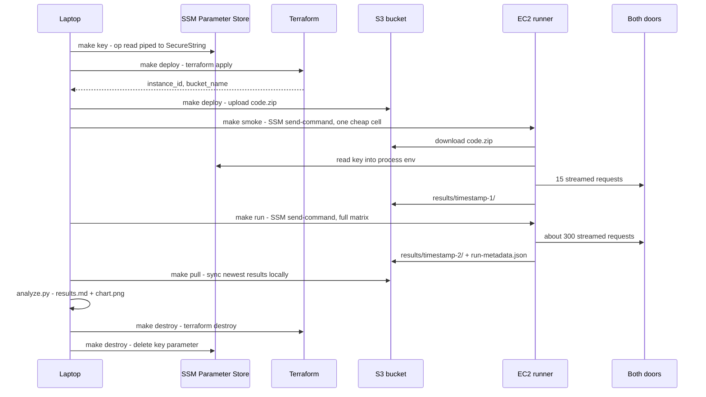
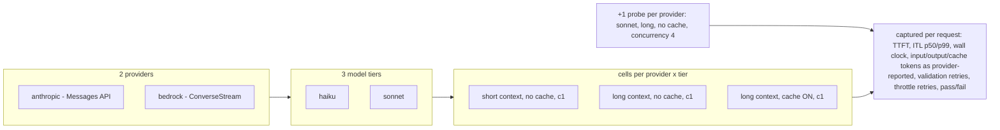
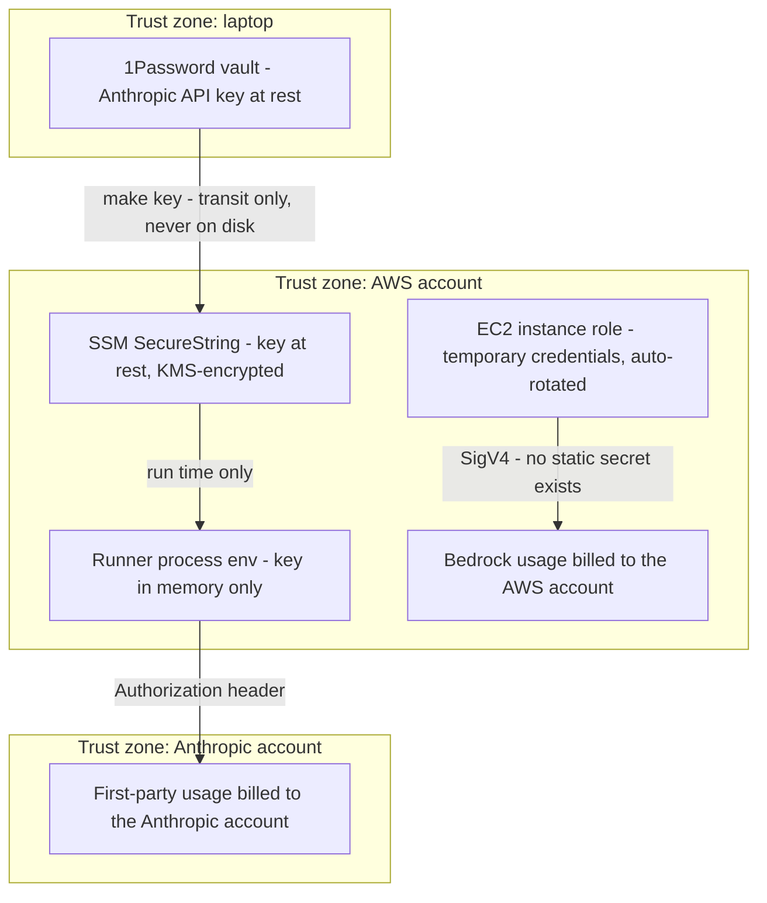

# Architecture

This document is the visual companion to `README.md` (what and why),
`RUN-EC2.md` (the operational checklist), and `WALKTHROUGH.md` (the code
tour). All diagrams are Mermaid: they render natively on GitHub, diff like
text, and age better than binary images.

---

## 1. System architecture

The rig has one deliberate shape: the laptop is a control plane only. Code
travels to the runner through S3, the secret travels through SSM Parameter
Store, and measurements travel back through S3. Nothing dials into the
instance - it has no SSH, no key pairs, and a security group with zero
ingress rules. The two "doors" being measured are the only things the runner
talks to besides AWS control services.

Properties worth noticing:

| Property | Where it is enforced |
|---|---|
| No inbound network path to the runner | Security group with zero ingress rules; SSM Session Manager is the only access channel |
| API key never on disk, never in Terraform state | `make key` pipes `op read` straight into an SSM SecureString; `run_remote.sh` reads it into process env only |
| Least-privilege runner | Instance role grants exactly: Bedrock invoke, one SSM parameter path read, one bucket |
| Instance metadata hardened | IMDSv2 required (`http_tokens = "required"`) |
| Every result set traceable | `run-metadata.json` records instance type, region, AZ, UTC timestamp, and a sha256 over the shipped code |

## 2. Run lifecycle

Six make targets, one afternoon, teardown the same day. The sequence below is
the whole operational surface - there is no dashboard, no daemon, and nothing
that runs unattended. Note the last step: `make destroy` deletes the key
parameter along with the infrastructure, so an idle rig never leaves a live
credential behind.

## 3. The measurement matrix

The matrix is 20 cells: 2 providers x 3 model tiers x the context/cache
combinations below, plus one deliberate concurrency probe per provider. The
cache axis exists only for the long context because the short prompt sits
below both providers' minimum cacheable prefix - a short+cache cell would
silently no-op and report a fake "no caching effect" result. Every cell runs
N=15 requests, one per eval document.

Totals: (2 tiers x 3 context/cache cells + 1 concurrency probe) x 2
providers = 20 cells, 300 requests. Derived per cell by `analyze.py`: output
tokens/sec, cost per completed task, goodput (completed tasks per minute),
pass rate.

## 4. Trust boundaries

Two credentials exist and they never cross: the Bedrock door authenticates
with the instance's IAM role (no key material anywhere), and the first-party
door authenticates with an API key that lives only in an SSM SecureString and
the runner's process environment. The bills land in different places for the
same reason - that split is itself part of what the benchmark demonstrates.

What is deliberately NOT in any tracked file: account IDs (the bucket name
derives one at apply time, inside your own state only), API keys, personal
1Password item names (those live in the gitignored `local.mk`), and
Terraform state (gitignored - state can carry resource attributes you do not
want published).
