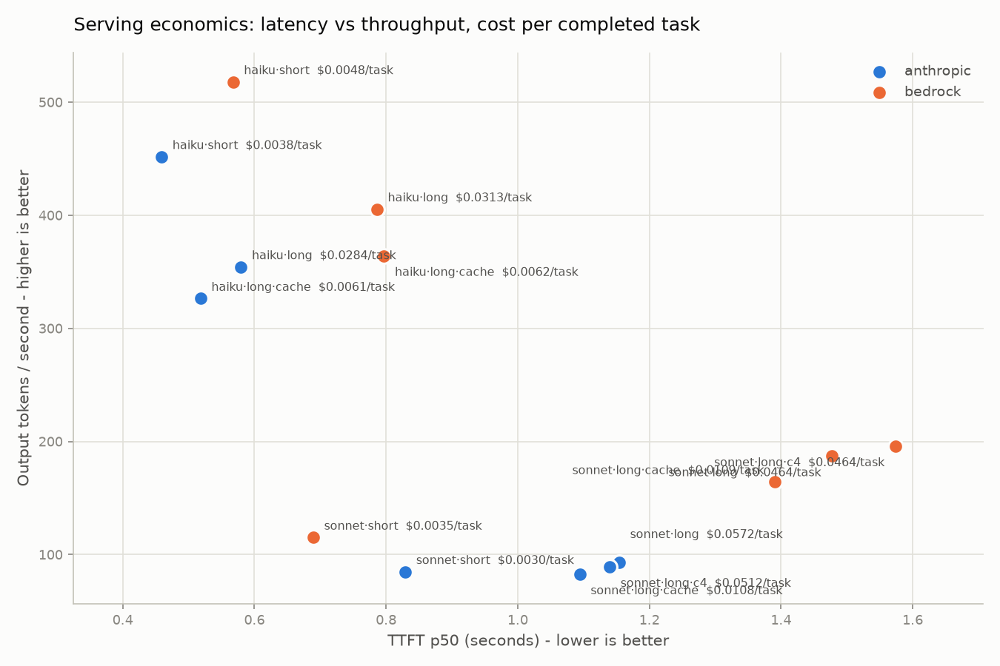

# Findings - 25 July 2026 run

One afternoon, one task, two doors, 210 measurements. This is a dated snapshot: the harness is the durable asset, these numbers are not. Method and boundaries in [README.md](README.md); pre-registered hypotheses in [explainer.html](explainer.html) section 9, where each verdict badge now sits next to the prediction it answered.

**Setup:** structured-extraction task (fixed JSON schema, machine-scored pass/fail against an answer key), 15 requests per cell, two Claude tiers (Haiku 4.5 and Sonnet 4.6) measured through both Amazon Bedrock (us.* regional inference profiles, us-east-1) and the Anthropic first-party API, two context lengths, prompt caching on/off, plus one concurrency-four probe, client on an in-region EC2 instance. 14 cells, 210 measurements. Total API spend: about $4.30.

## The six findings

### 1. The capability ladder is real, and it reprices the tiers
Pooled pass rates: **Haiku 72% - Sonnet 98%.** Haiku stayed cheapest per *completed* task everywhere ($0.034 vs Sonnet $0.045, short context) - but retries shrank its 3x sticker advantage to about 1.3x effective, and 28% of its tasks never completed within three attempts. The cheap model wins only inside an escalation pattern: route to Haiku first, escalate its failures. Sticker price told none of this.

### 2. Haiku's failure mode is instruction literalism, not extraction quality
Asked for a case-insensitive **literal substring match** against a phrase list, Haiku consistently reported phrases that were not in the document - inferring "limited time" from "enrollment closes on March 31." It pattern-matches meaning where the instruction demands mechanics, then wavers reconciling its own count with the derivation rule. Controllability - reliability at following the boring instruction exactly - is what the mid tier is actually selling.

### 3. Prompt caching is the biggest lever in the dataset
About **5x cheaper per completed task** on long context, consistent across both tiers and both doors (Haiku $0.34 to $0.07; Sonnet $0.80 to $0.16). Where the repeated prefix is below the minimum cacheable size, caching silently does nothing - by design, and worth knowing before assuming the discount.

### 4. The cross-door delta has a shape, not a sign
- **Cost:** Bedrock's regional (us.*) tier lists a uniform +10% over first-party (AWS Price List API; the global-routing tier is at parity). But on Sonnet long-context, Bedrock landed **13% cheaper per completed task despite the premium** - completion-rate differences can invert a sticker gap at the unit that matters.
- **Latency:** first-party mostly answered first (Bedrock TTFT +24% to +54%), except Sonnet short-context, where Bedrock won by 17%. Workload-dependent, as pre-registered ("we do not predict the sign").
- **The split:** on Sonnet long-context, **first-party starts sooner (TTFT 1.15s vs 1.48s) and Bedrock finishes sooner (total 2.1s vs 2.8s).** The two doors optimize different halves of the same request - one for the first token, one for the last.

### 5. A metric lied, exactly where the pre-registration said one might
Measured inter-token latency showed Bedrock about 90% "faster" - an artifact. The metric times stream **events**, and the doors chunk differently (first-party emits fewer, larger deltas). Inter-event cadence is not inter-token cadence; the cross-door ITL comparison is invalid without token-level accounting. The trap-corner list predicted the numbers could lie; this is the one that did, and wall clock is the honest substitute.

### 6. Enablement friction is a delta component too
Between "I have an AWS account" and "Claude answers through the AWS door" this run walked five gates: an inference-profile ID format, a Marketplace IAM permission (aws-marketplace:Subscribe), a retired console flow replaced by invoke-to-enable, Anthropic's one-time use-case form, and per-model first-invokes that a least-privilege workload role deliberately cannot perform for itself - someone with broader rights walks each model through its door once. The first-party door needed one API key. The enterprise wrapper's value and its friction are the same coin, and neither appears on a pricing page.

## Boundaries (they travel with every claim above)

Small N (15/cell; p50s are indicative, p99s are theater). One task. One afternoon - a snapshot under unknown shared-fleet load, from one region. Hosted APIs only: no accelerator or fleet-level claims. Findings are directional instruments, not verdicts; the pre-registration (with two amendments, both documented in-code and in the run docs) is the audit trail.

*Prices and behavior verified 25 July 2026 and will drift. Rerun the harness before quoting anything here.*
