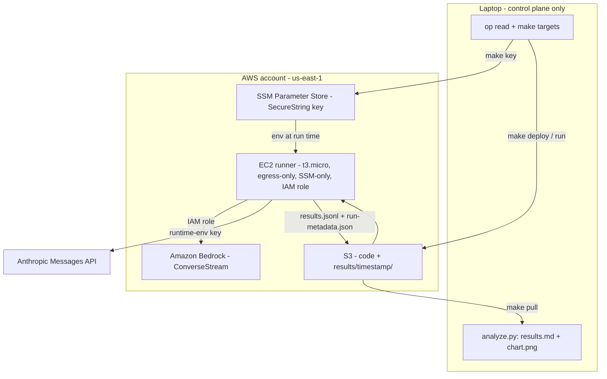

# serving-economics-bench

**Measures cost per completed task, not per token, across two serving doors.**

A small, runnable, provider-comparative inference benchmark: the same
structured-extraction workload measured against **Amazon Bedrock (Converse
API)** and the **Anthropic first-party Messages API**, across three Claude
tiers, two context lengths, and prompt caching on/off - reporting TTFT,
inter-token latency, tokens/sec, and cost per completed task. It ships with a
Terraform-provisioned in-region EC2 runner so the home ISP is not inside any
latency number, and a calibrated-claims file (`CLAIMS.md`) that states
exactly what one run does and does not license you to say. One afternoon to
run, about $4.50 all-in. The point is the method, not the sample size.



Full diagrams (run lifecycle, measurement matrix, trust boundaries):
**`ARCHITECTURE.md`**. Narrated code tour: **`WALKTHROUGH.md`**.

---

## The mental model: five axes of the serving layer

Every inference-serving decision is a position in a five-axis trade space.
Naming the axes is what turns "which model should we use" into an engineering
question:

```
quality          what fraction of tasks come back correct and usable
   |
latency          TTFT (time to first token) + inter-token latency
   |
cost             $ per unit of USEFUL work, not $ per token
   |
controllability  caching, quotas, retries, schema enforcement, observability
   |
deployment       who runs the serving layer: first-party API, cloud
                 marketplace (Bedrock), or your own accelerators
```

Most benchmarks measure one axis (usually latency or tokens/sec) and let the
others ride. The unit that connects them is **cost per completed task**: a
task that fails schema validation gets retried, and the retry's tokens are
real money - so quality failures surface as cost, and cost and quality stop
being separate conversations.

This project holds quality constant (one fixed extraction task with a known
answer key), sweeps latency and cost, and probes controllability (caching,
concurrency) across two points on the deployment axis: **first-party API vs
Bedrock**. That first-party-vs-marketplace delta on the same model class is
the interesting part - a miniature of the question every serving-layer owner
carries: what do you gain and give up at each deployment tier?

## The matrix

| Axis | Values |
|---|---|
| Provider | Anthropic first-party Messages API · Amazon Bedrock ConverseStream |
| Model tier | Haiku (`claude-haiku-4-5`) · Sonnet (`claude-sonnet-4-6`) |
| Context | short (about 500 input tokens) · long (about 9K input tokens) |
| Prompt caching | off · on (**long context only** - see below) |
| Concurrency | 1 for all cells · one extra probe at 4 (Sonnet, long, no-cache) |
| N | 15 requests per cell (one per eval document) |

20 cells, 300 requests total.

**Design decisions and why:**

| Decision | Why |
|---|---|
| Cache axis exists only for the long context | The short prompt is below the minimum cacheable prefix on both providers (1,024-4,096 tokens depending on model). A short+cache cell would silently no-op and report a fake "no caching effect" result. |
| Sonnet tier = Sonnet 4.6, not Sonnet 5 | Sonnet 5 runs adaptive thinking by default (a confound in a serving benchmark - thinking tokens pollute latency and cost) and carries introductory pricing. Sonnet 4.6 runs thinking-off when the field is omitted, matching Haiku 4.5, so the tiers are apples-to-apples. |
| `max_tokens` fixed at 1,024 | On Bedrock, `input_tokens + max_tokens` is reserved 1:1 against the TPM quota at request start. An oversized `max_tokens` throttles concurrency and distorts the concurrency-4 cell. |
| No `temperature`, no `thinking` config | some current Claude models reject sampling parameters with a 400; omitting them everywhere keeps requests identical across providers and models. |
| Concurrency probe on Sonnet only | Shows the concurrency effect on one mid-tier model without tripling cost. |
| Bedrock via Converse/ConverseStream only | Converse is the unified surface; caching, usage reporting, and streaming all map onto it. The legacy InvokeModel path is deliberately not used. |

**The task:** each request extracts a fixed JSON schema (jurisdiction, claims
made, prohibited phrases, derived risk level) from one of 15 bundled
synthetic insurance direct-mail documents (`eval/`, all company names
fictional). A completed task = valid JSON + schema keys + exact jurisdiction
and risk level + set-equal prohibited phrases + claims recall at or above
0.5, scored deterministically against a bundled answer key. Failed attempts
retry up to 2 times, and **retry tokens count into cost per completed
task** - that is the whole point of the metric.

## Quickstart

### Laptop-only path (including a zero-spend dry run)

```bash
# 1. Zero-spend pipeline validation - no credentials needed
uv run bench.py --dry-run && uv run analyze.py
rm results.jsonl            # clear mock rows before any real run

# 2. Credentials (never written to disk)
export ANTHROPIC_API_KEY="$(op read 'op://Personal/Anthropic API Key/credential')"
export AWS_DEFAULT_REGION=us-east-1   # plus your usual AWS auth for Bedrock

# 3. Smoke test one cheap cell, then the full run
uv run bench.py --provider anthropic --cells "anthropic:haiku:short"
uv run bench.py --provider both
uv run analyze.py
```

Full checklist with eyeball checks and a troubleshooting table: **`RUN.md`**.

### Terraform rig path (the primary path for a real run)

Runs the client from an in-region t3.micro instead of the laptop, which
removes the home ISP from every TTFT measurement. No SSH, no key pairs, SSM
only; the API key travels 1Password -> SSM SecureString -> runner process
env and never touches disk or Terraform state.

```bash
make key && make deploy && make smoke && make run && make pull && make destroy
```

Full checklist, cost notes, and the client-symmetry honesty note:
**`RUN-EC2.md`**.

## Cost to run

As of July 2026, computed from `pricing.json` via `uv run bench.py
--estimate`: about $2.63 on the Anthropic side, with Bedrock's regional
(`us.*` inference profile) tier carrying a uniform 10% premium over
first-party list at identical token volume - roughly **$5-6 in API spend for
the full 300-request matrix**, plus a few cents of EC2/S3/EBS for the rig.
Call it **about $4.50 all-in**. Re-run `--estimate` before trusting these
numbers; prices move.

## What this is / what this is not

**It is** a method demonstration: a small-N (15 requests/cell),
provider-comparative measurement of serving economics on hosted APIs, with a
task-level success criterion so cost is denominated in completed work. It is
honest about its error bars: at N=15, p50s are meaningful and p99s are
indicative only.

**It is not** fleet-scale serving, load testing, or capacity planning. It is
not an accelerator-level measurement - it never touches the layer below the
hosted API. It is not a model-quality benchmark (the task is deliberately
easy, so quality differences show up as retry cost, not as a leaderboard).
And its Bedrock-vs-first-party delta is a point-in-time reading of two
managed services, not a statement about either platform's ceiling.

The full calibrated-claims framework - every sentence a run does and does
not license - is **`CLAIMS.md`**, and it is part of the artifact on purpose.

## Pre-registration

Five hypotheses were written down **before** the run - section 9 of
**`explainer.html`** (open it in a browser). Predictions vs actuals is the
planned deliverable; misses get equal billing with hits. The same file walks
the serving-economics mental model interactively (the latency/throughput/cost
triangle, the batching curve, the retry-crossover widget).

## Repo map

| File | What |
|---|---|
| `bench.py` | The harness. uv-runnable (PEP 723 inline deps). `--dry-run`, `--estimate`, `--provider`, `--cells`. Appends to `results.jsonl` (resumable). |
| `analyze.py` | Aggregates `results.jsonl` + `pricing.json` into `results.md` and `chart.png`. |
| `pricing.json` | The only place prices live, with source and date per provider. |
| `eval/` | 15 synthetic documents + expected outputs (the answer key). |
| `ARCHITECTURE.md` | System, lifecycle, matrix, and trust-boundary diagrams (Mermaid). |
| `WALKTHROUGH.md` | Narrated code tour - design decisions and trade-offs. |
| `RUN.md` | Laptop-local checklist, including the zero-spend dry run. |
| `RUN-EC2.md` | EC2-runner checklist - the primary path for a real run. |
| `Makefile` | The rig's six targets: key, deploy, smoke, run, pull, destroy. |
| `terraform/` | The runner infrastructure (EC2 + IAM + S3 + SSM access). |
| `run_remote.sh`, `push_results.sh` | Runner-side helpers shipped in the code zip. |
| `explainer.html` | Interactive explainer + the pre-registration (section 9). |
| `CLAIMS.md` | Exactly what may and may not be claimed after running this. |

## Aging well

Design decisions that keep this reproducible after the numbers go stale:

- **Prices live in `pricing.json` only**, each block with its source and
  pull date, and a verify-before-quoting rule baked into the tooling:
  placeholder values make `analyze.py` report `n/a` and `--estimate` refuse
  to guess, rather than fabricate.
- **Model IDs are configured in one place** (`MODELS` at the top of
  `bench.py`); swapping a tier or updating an inference-profile ID is a
  one-line change.
- **Every run emits `run-metadata.json`**: instance type, region, AZ, UTC
  timestamp, and a sha256 over the shipped code - so any result set is
  traceable to the exact code and vantage point that produced it.
- **Results are dated snapshots; the harness is the durable asset.** Run
  artifacts (`results.jsonl`, `results.md`, `chart.png`) are gitignored by
  design - rerunning takes an afternoon, and the measurement discipline does
  not expire.
- **Provider SDK versions are pinned as floors** in the PEP 723 headers
  (`anthropic>=0.66`, `boto3>=1.35`, `matplotlib>=3.8`), and the Terraform
  provider is version-constrained with a committed lock file.

## License

MIT - see `LICENSE`.
